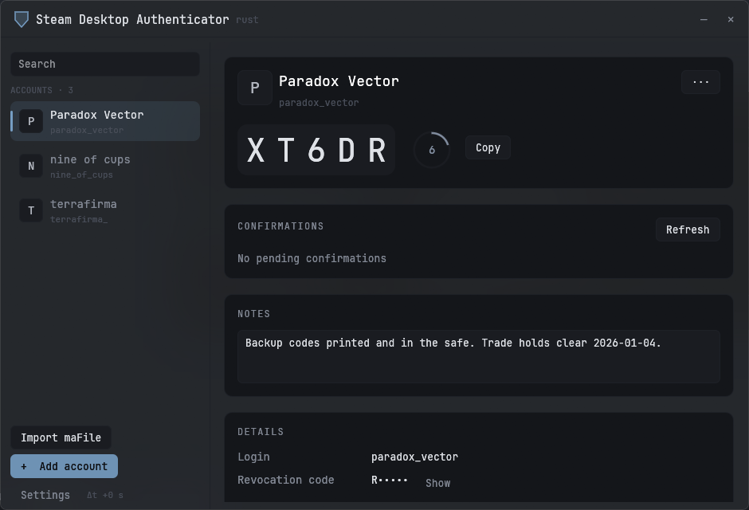
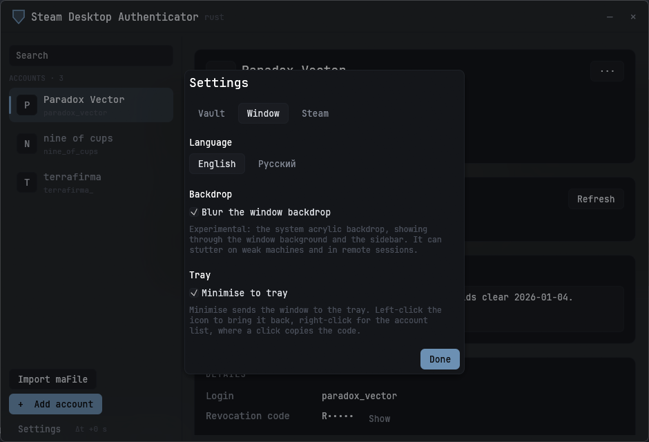

# SDA

A Steam Desktop Authenticator for Windows, written in Rust. It generates Steam Guard
codes, handles trade and market confirmations, and reads the same `maFiles` the
original [SteamDesktopAuthenticator](https://github.com/Jessecar96/SteamDesktopAuthenticator)
writes, so you can point it at a folder you already have.



<details>
<summary>Settings</summary>



</details>

## Features

- Steam Guard codes with a countdown ring, one click to copy
- Trade and market confirmations: accept or reject, one at a time or all at once
- Add a new authenticator, re-sign in, or remove an authenticator with its revocation code
- Import existing `maFiles` from the original SDA
- Several accounts with aliases, private notes, and drag-to-reorder
- Optional `maFiles` encryption, in the original SDA's format
- Tray icon: right-click for the account list, click an account to copy its code
- English and Russian interface, following the system language by default
- Optional acrylic window backdrop
- Optional persona name and avatar from the public Steam profile, no Web API key needed

## Install

Grab `sda.exe` from [Releases](../../releases) and run it: no installer, no runtime to
install. Each release ships a `.sha256` next to the binary. Or build it yourself.

## Build

Needs a [Rust](https://rustup.rs) toolchain. Nightly is not required.

```sh
cargo build --release
```

The binary lands in `target/release/sda.exe`.

The executable's icon is generated by `build.rs` and compiled into a Win32 resource,
which needs `rc.exe` from the Windows SDK. Without it the build still succeeds and
prints a warning; only the file icon is missing.

## Where things live

| Path | What |
| --- | --- |
| `%APPDATA%\SDA\config.json` | App settings: language, maFiles folder, backdrop, tray |
| `%APPDATA%\SDA\maFiles\` | Default vault: `manifest.json` plus one `.maFile` per account |
| `%APPDATA%\SDA\maFiles\sda_meta.json` | Aliases, notes and ordering (this app only) |

You can point the app at a different `maFiles` folder under Settings → Vault, including
one the original SDA already uses.

## Security

Your `shared_secret` and `identity_secret` live in the `maFiles`. Anyone who can read
them can generate your codes, so treat that folder like a password vault.

Encryption is off by default, which matches the original SDA. Turning it on under
Settings → Vault derives a key with PBKDF2-HMAC-SHA1 (50 000 rounds) and encrypts each
file with AES-256-CBC. Aliases and notes are encrypted alongside them. There is no
password recovery: lose the password and the files are gone, so keep a backup.

The app talks to Steam's own endpoints and nothing else. There is no telemetry and no
update check.

## Project layout

| File | What |
| --- | --- |
| `src/main.rs` | Application state and the eframe loop |
| `src/screens.rs` | The main window: title bar, sidebar, content cards |
| `src/modals.rs` | Modal dialogs and the settings window |
| `src/flow.rs` | Sign-in, enrolment and removal, as a state machine |
| `src/widgets.rs` | Small painting helpers shared by the screens |
| `src/theme.rs` | Palette, bundled font, base egui style |
| `src/config.rs` | The app's own settings file |
| `src/api.rs` | Steam Web API services: sign-in, enrolment, removal |
| `src/steam.rs` | Codes, confirmations, tokens, server time |
| `src/storage.rs` | The `maFiles` directory: reading, writing, encryption |
| `src/proto.rs` | Just enough protobuf for Steam's services |
| `src/tray.rs` | Tray icon, its menu and its Win32 message pump |
| `src/icon.rs` | The shield, drawn in code for the tray, the window and the .exe |
| `src/i18n.rs` | Language selection and string lookup |

## Contributing

Issues and pull requests are welcome. Before opening a PR:

```sh
cargo fmt
cargo clippy --all-targets
cargo test
```

Interface strings are not in resource files; `t("English", "Русский")` picks between
two literals at the call site, and `tf!` does the same for formatted messages. Adding a
language means extending `Lang` in `src/i18n.rs` and filling in the new arm.

## License

MIT, same as the original SDA. See [LICENSE](LICENSE).

The bundled [JetBrains Mono](https://github.com/JetBrains/JetBrainsMono) font is used
under the SIL Open Font License 1.1, copied in
[assets/JetBrainsMono-OFL.txt](assets/JetBrainsMono-OFL.txt).

Not affiliated with Valve. Steam and Steam Guard are trademarks of Valve Corporation.
